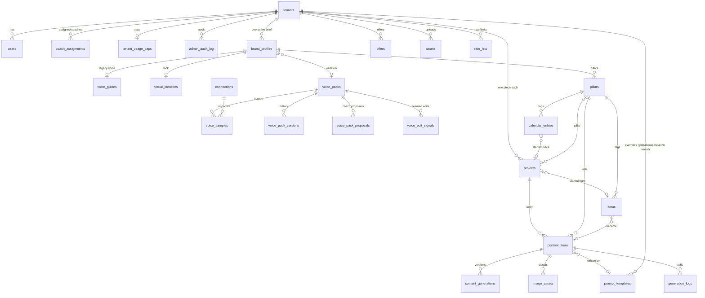

# Architecture note — Huemen.studio

Companion to [`AGENTS.md`](../AGENTS.md) (orientation) and the build brief. This
is the "architecture note" required at handover (brief §11, TASKS P4-14).

## Shape

Next.js (App Router) monolith + Postgres. No exotic infra — the client owns and
runs this after handover, in their own accounts.

```
Browser ── Next.js (RSC, server actions, route handlers) ──┬── Postgres (RLS)        tenant data, rate limits, logs
   │                                                       ├── Object storage (S3)   uploads; served via signed app links
   │                                                       ├── AI facade             Claude (stand-in writer locally)
   │                                                       └── Resend                sign-in links and invites
   └── direct upload (presigned PUT) ──────────────────────── Object storage
```

There is no job queue: every generation runs in the request (the `jobs` table
exists, unused; see `docs/phase-two.md`). Long chains are bounded by
`AI_TEXT_TIMEOUT_MS` and, on serverless hosts, the function time limit.

## Tenant isolation (INV-1) — the load-bearing design

Two lines of defence, DB first:

1. **Postgres RLS (primary).** Every table has `tenant_id` (`tenants` is keyed
   by `id`); every table has `ENABLE` + `FORCE ROW LEVEL SECURITY` and a
   `tenant_isolation` policy keyed to `app.current_tenant` (a transaction-local
   GUC). See [`migrations/0002_rls.sql`](../migrations/0002_rls.sql) and each
   later migration. Cross-table links that a foreign key would otherwise allow
   across tenants are keyed `(id, tenant_id)` (0010, 0011, 0013, 0019).
2. **Application scope (secondary).** The app connects as the non-owner role
   `huemen_app`, so RLS always applies; the migrator refuses to finish if that
   role is a superuser or has BYPASSRLS. Every request-serving query runs inside
   [`withTenantSession`](../src/db/session.ts), which sets the GUCs from the
   VERIFIED session — never from client input. Access is refused early by
   [`resolveScope`](../src/lib/auth/scope.ts); workspace pages and handlers run
   with the admin flag off.

Admin cross-tenant reads (workspace management + usage analytics) are an
*additional* `admin_all` policy on management/log tables only. Client CONTENT
tables have no admin bypass, so an admin-code bug cannot leak one client's
content to another.

Tested from three sides, all in CI and blocking merge:
[`tests/isolation.test.ts`](../tests/isolation.test.ts) (cross-tenant reads and
writes fail), [`tests/security.test.ts`](../tests/security.test.ts) (RLS
enabled, forced and with a policy on every table, read from the catalog; no
views; role reach), [`tests/endpoint-gates.test.ts`](../tests/endpoint-gates.test.ts)
(every server action and route checks a session, scope or signed link).

## Identity and sessions

Invite-only, passwordless ([`src/lib/auth`](../src/lib/auth)). A person proves
who they are with a one-time emailed link (signed, 15 minutes, used up on
sign-in; opening the link shows a Continue button so mail scanners can't use it
up). The session is a signed cookie that carries its own 8-hour expiry; the
account is re-read on every request, so turning someone off, archiving their
workspace or changing their role applies at once. Roles: owner-admin (every
workspace), coach (own organisation + assigned workspaces), client (own
workspace). Production refuses the dev one-click sign-in and the example secret.

## The brand context object (INV-2) — the anti-drift design

`brand_profiles + voice_packs (or the legacy voice_guides) + visual_identities`,
with pillars, strategy answers and offers, compose into ONE serialised,
versioned block via [`buildBrandContext`](../src/lib/context/context-builder.ts)
(pure, unit-tested) loaded by
[`loadBrandContext`](../src/lib/context/context-loader.ts). Every prompt is
assembled by the AI facade as **system template + context block + task input**.
`CONTEXT_VERSION` names the block's shape; what is stamped on each content item
is the template version that wrote it (`prompt_version`, `prompt_template_id`).
No module builds its own context: [`tests/context-invariant.test.ts`](../tests/context-invariant.test.ts)
fails the build if data or page code writes brand data into a task input.

## AI layer

[`src/lib/ai`](../src/lib/ai) — one facade for text (`generateText`,
`streamText`, `runTask`), transcription and images, provider + model chosen from
env config. Before any provider call: a per-minute limit per person and per
workspace ([`lib/ratelimit`](../src/lib/ratelimit.ts), counted in Postgres) and
the monthly hard cap. Retry policy lives once in the facade; every call,
including a stream abandoned mid-way, writes a `generation_logs` row. Tasks
(structured answers: topics, checks, rewrites, pre-fill, the 90-day plan) are a
registry in [`tasks.ts`](../src/lib/ai/tasks.ts), each with a schema, a default
template and a deterministic stand-in so every flow runs with no key. Built
providers: the stand-in and Anthropic (Claude). Visuals are templates, not image
models.

## Storage and uploads

[`src/lib/storage`](../src/lib/storage) — local disk for development, S3
(AWS S3, Supabase Storage, R2) in production. Keys are always tenant-prefixed.
Files are read through the app's own short-lived signed links, served with
nosniff, a sandboxing CSP and download-unless-image. Uploads go straight from
the browser to storage on a one-time signed PUT (exact size and type), then the
server reads them back, checks the real type from the bytes (SVGs with active
content are refused), and stores them. Small files fall back to the app's relay
when the bucket can't be reached from the browser.

## Operations

- `GET /api/health`: 200 when the database answers, 503 when it doesn't.
- Logs go to the host's console output; there is no error tracker yet.
- Migrations: `npm run db:migrate`, re-runnable, from empty, without superuser.
  Every migration has a rollback in `migrations/rollback/`; those for 0001,
  0002 and 0007 say plainly what they cannot bring back.
- Admin changes are written to `admin_audit_log` in the same transaction and
  readable in Settings › Audit log.

## Data model

The core objects from brief §03, grown during the build. Every table also
carries `tenant_id` → `tenants` (not drawn). Workspace-level rows have
`project_id IS NULL` (migration 0007): a project is one piece of work.



Columns and constraints are in [`migrations/`](../migrations), read in order.
`jobs` exists unused; `visual_identities.logo_asset_id` exists unused (visuals
use the newest uploaded logo).

## Local dev

Postgres via [`docker-compose.yml`](../docker-compose.yml) on host port **5544**
(avoids a native Postgres on 5432). See [`README`](../README.md).
